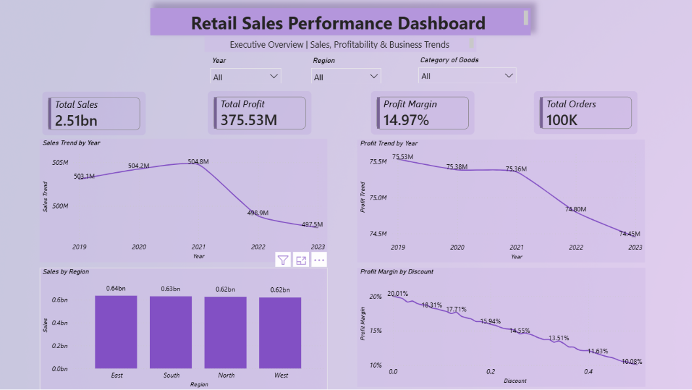
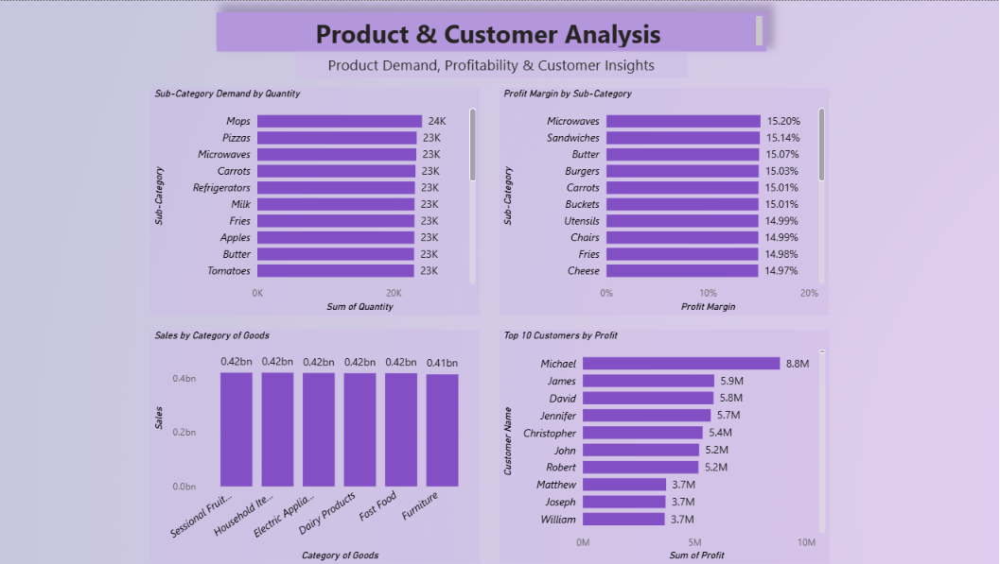
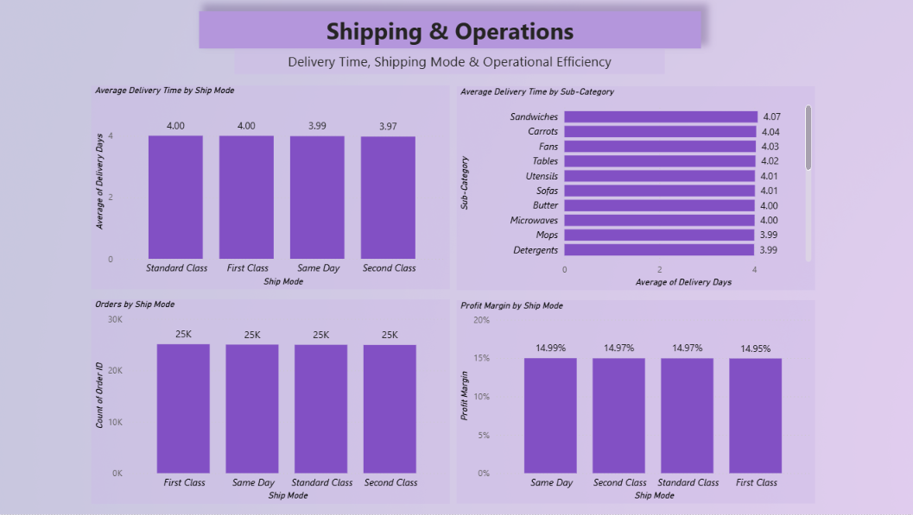

# Retail Sales Analysis

## Project Overview
An end-to-end Retail Sales Analysis project focused on understanding sales performance, profitability, product demand, customer contribution, and shipping operations using Excel, PostgreSQL, Python, and Power BI.

## Business Objectives
- Analyze sales and profit trends from 2019 to 2023.
- Compare performance across regions, customer segments, and product categories.
- Evaluate discount levels and their association with profit margins.
- Identify high-demand sub-categories and profitable customer groups.
- Analyze order volumes and delivery durations across shipping modes.
- Develop actionable business recommendations based on the findings.

## Tools & Technologies
- Microsoft Excel — Data validation and exploratory analysis
- PostgreSQL — SQL queries and business analysis
- Python (Pandas) — Data analysis
- Power BI — Interactive dashboards, KPIs, and visualizations

## Key Findings
- Total sales were approximately ₹250.84 crore.
- Total profit was approximately ₹37.55 crore.
- Overall profit margin was approximately 14.97%.
- East recorded the highest regional sales and profit.
- Sales peaked in 2021 and were lowest in 2023.
- The 50% discount group had a lower profit margin than the zero-discount group. This is an observed association, not proof of causation.
- Average delivery duration was approximately four days.

## Dashboards
1. Executive Overview — Sales, profit, KPIs, and trends
2. Product & Customer Analysis — Product demand, margins, and customer profitability
3. Shipping & Operations — Delivery durations, order volumes, and shipping-mode profitability

### Dashboard Previews

#### Executive Overview

#### Product & Customer Analysis

#### Shipping & Operations

## Limitations
The dataset contains no cost column and no negative profit values. Therefore, reliable loss analysis and shipping cost-efficiency analysis could not be performed.

## Business Recommendations
- Investigate the decline in sales and profit after 2021.
- Review discount strategies and monitor their relationship with profit margins.
- Monitor high-demand sub-categories and profitable products.
- Continue tracking delivery performance across shipping modes.

## Project Status
Completed — End-to-end retail sales analysis using Excel, PostgreSQL, Python, and Power BI, including business insights, interactive dashboards, and recommendations.
